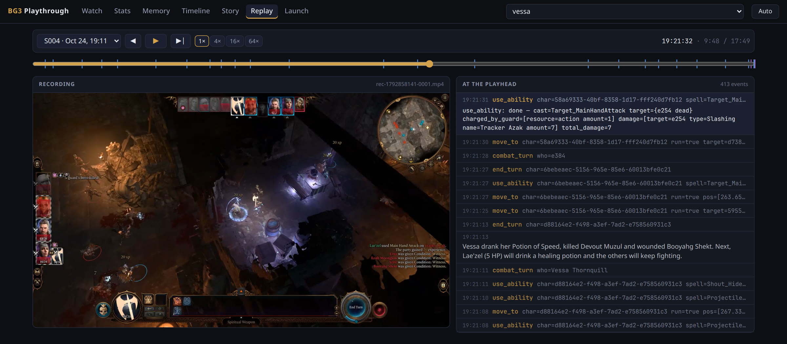
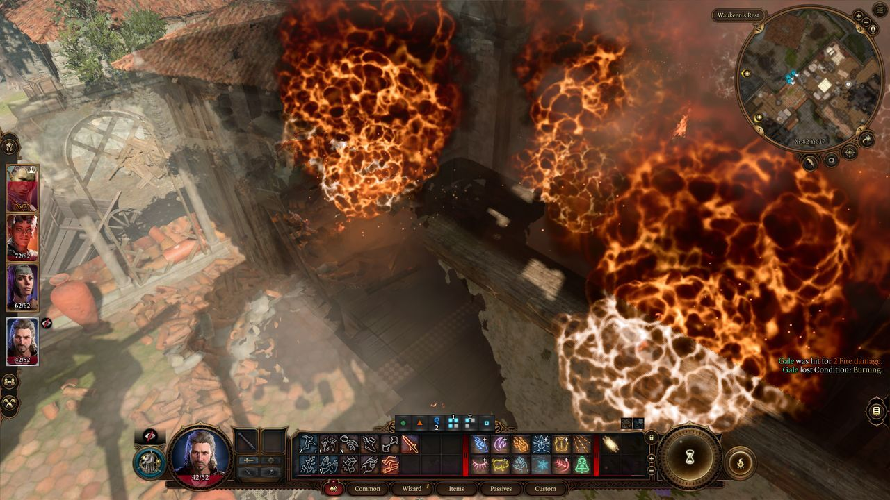
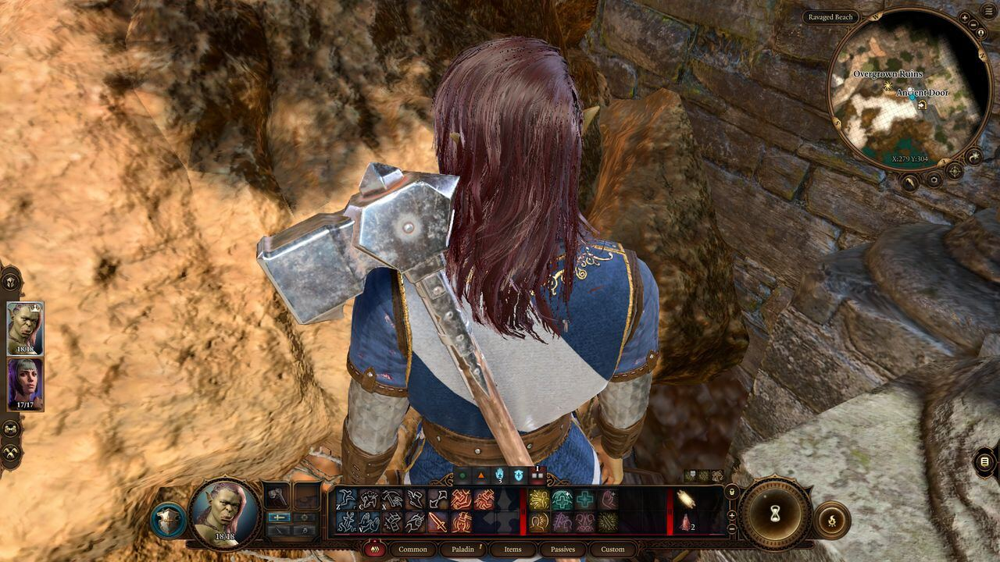
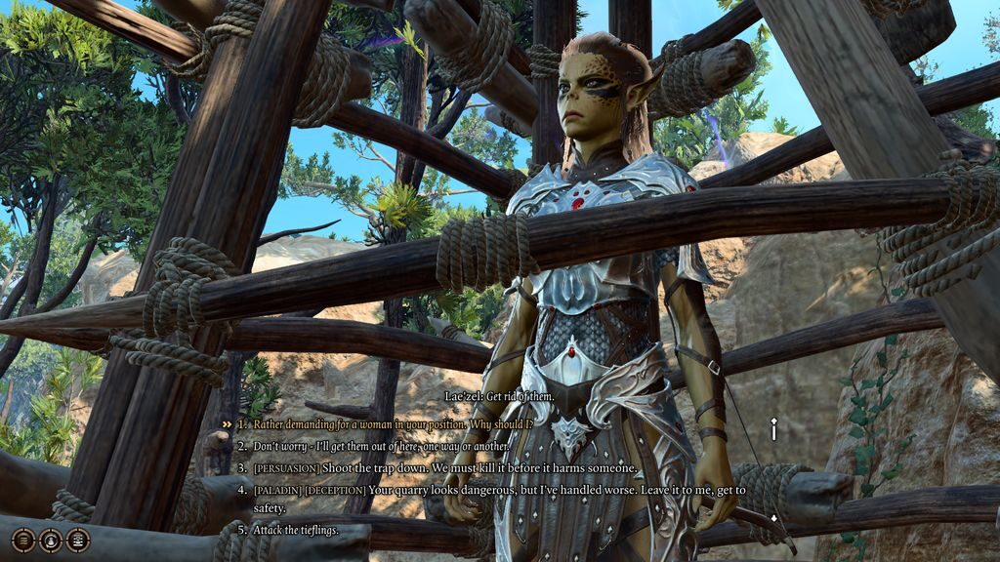
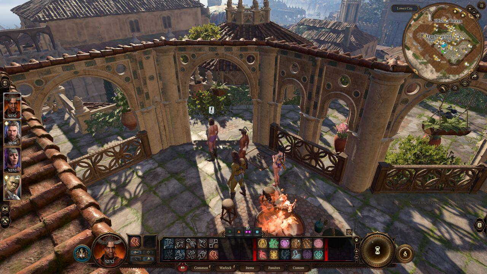
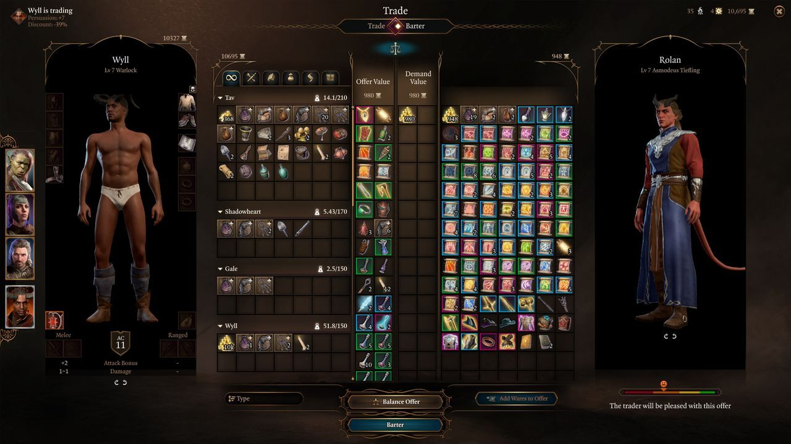
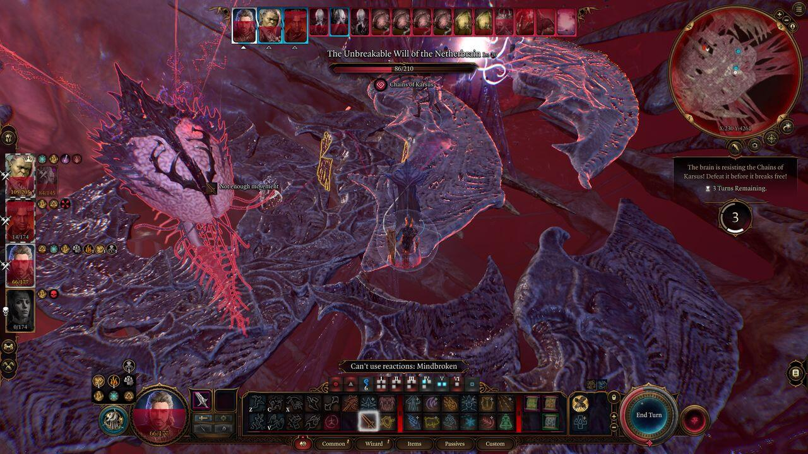
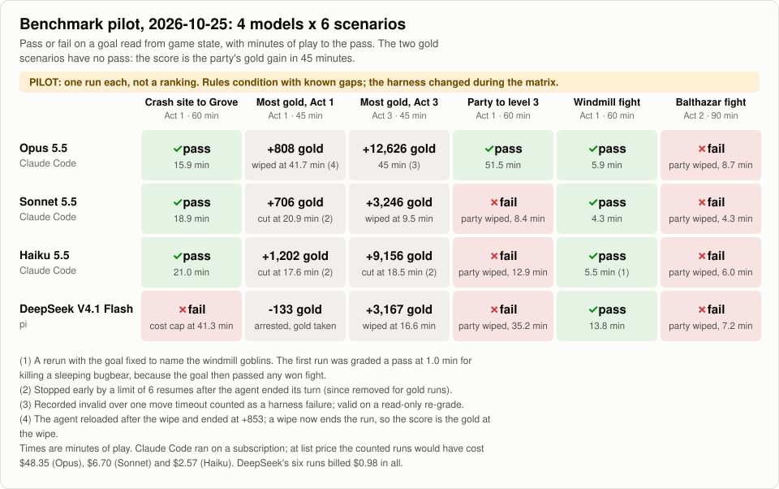
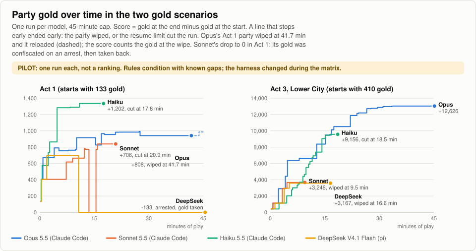
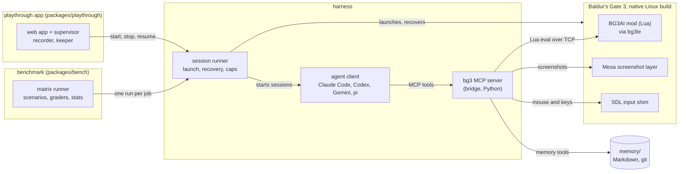

# bg3-agent-harness

An AI agent playing Baldur's Gate 3, plus the tools to run it, measure it and watch it.

[](LICENSE)
[](pyproject.toml)
[](docs/SETUP.md)
[](#limits)



<sub>The playthrough app's Replay page on a recorded session: the `vessa` playthrough (Claude Opus 5.5, Balanced),
session S004 on 2026-10-24, a fight in Act 1. On the left, the recording of the game window; on the right, the
agent's tool calls and what it said, in step with the playhead.</sub>

A Lua mod inside the game reads what a player could see and carries out the agent's actions. An MCP server (the
bridge) turns that into tools any MCP client can call, and a harness launches the game, starts the agent and
recovers from crashes. On top of the harness sit a benchmark for comparing models and an app for watching an agent
play the whole game.

The agent plays fair: it gets only what is on screen or what it remembers having seen, and it acts through the
game's own UI, engine actions, and mouse and keyboard input. The mod runs through
[bg3le](https://github.com/lenonk/bg3le), a Linux port of Norbyte's Script Extender, on the native Linux build of the
game.

This is a research project and a work in progress. It has finished the game once. Setup needs Linux, a Steam copy of
the game and some patience, and things break when the game updates.

## See it play

These are screenshots the agent took for itself with its screenshot tool, at the size it saw them.

| | |
|---|---|
|  |  |
| claude-run-2 (Opus 5.5 through Claude Code), session S021, 2026-10-10: the burning inn at Waukeen's Rest in Act 1. | Benchmark, `crash_site_grove` (Opus 5.5, 2026-10-25): the half-orc paladin on the Ravaged Beach, 40 seconds into a run whose goal is the Emerald Grove. |
|  |  |
| Benchmark, `act1_level_3` (Opus 5.5, 2026-10-25): Lae'zel caged by tieflings. The agent reads the options and picks one with a skill check. | Benchmark, `act3_gold_max` (Opus 5.5, 2026-10-25): a rooftop in the Lower City, in a 45-minute run scored on the gold the party gains. This was the second attempt, voided for a harness failure; the first one is the result below. |
|  |  |
| The same voided attempt: Opus sold through Wyll, who got 39% of each item's value from the traders. In the counted attempt it sold as Tav and got 25%. | Spoiler, the end of the game: claude-run-2, session S096, 2026-10-18, the final fight. That session went on to the epilogue. |

The [playthrough app](docs/APP.md) shows the same runs from the outside: the game recording, what the agent says,
its tool calls, the party, its memory and a timeline of its choices and fights.

## What it has done

These runs used the harness from before the reorganisation that became `main` on 2026-10-22.

| | claude-run-2 (full game) | Nautiloid series (opening chapter) |
|---|---|---|
| Goal | new game to the epilogue | new game until the party escapes the Nautiloid |
| Dates | 2026-10-09 to 2026-10-18 | 2026-10-13, 2026-10-16/17, 2026-10-17 |
| Result | reached the epilogue | 9 of 9 runs reached the goal |
| Sessions | 96 numbered (99 with crash restarts) | 3 series of 3 runs |
| Play time | 38.9 hours | 9 to 13 minutes of wall time per run |
| Model cost | $711, memory keeper included | mean per run: $4.34 in the first series, $3.30 in the second, $1.46 in the third |
| Tool calls | 20,809 | |
| Fights | 149 recorded by the harness, 91 of them with a reload | |
| Model | Claude Opus 5.5, medium effort | Claude Opus 5.5 |
| Difficulty | Explorer | Explorer |

The harness was fixed and improved while claude-run-2 went on, so the run shows the whole game can be finished
through it. It is not a controlled measurement. Fights are the harness's own records, one per fight, graded when it
ends.

On the reorganised code, the first live runs were checks, not benchmark results:

- Claude Code (Opus 5.5) escaped the Nautiloid in 15.2 minutes of play, and again in 12.1 minutes through the
  benchmark runner. That second run had unseeded dice and didn't stop at the goal, so it doesn't count.
- DeepSeek Flash through the pi client escaped the Nautiloid in 24.6 minutes of play, billed $0.19. An earlier
  attempt hit a $0.50 cost cap after 40 minutes in the final fight ($0.24 billed), and a run from the crash site to
  the Emerald Grove reached it in 33 minutes for $0.18.
- A new playthrough at Balanced difficulty played one 48-minute session from character creation into Act 1 (the
  Emerald Grove and beyond) with no party deaths.
- Through the app, an existing playthrough played two sessions and came back from two forced game crashes, the
  second time resuming the same agent conversation.

## Benchmark

The goal is a suite of short scenarios that any model can be scored on: pass or fail on a goal read from game state,
with time, attempts and cost reported next to it.

- 30 scenarios in four families: 15 fights (five of them Tactician twins of a Balanced fight), 7 sandbox goals,
  5 choice scenes and 3 exploration legs. Six are held out. Each has a start, a goal (or, for the two gold
  scenarios, a score), caps and a closed-book quiz for contamination checks. Start saves are not published yet.
- The ranked track runs every model through one frozen client, pi, with the rules text only. Claude Code, Codex and
  Gemini CLI are a separate "bring your own agent" condition.
- Offline, a fake mod and a scripted model play scenarios end to end through the real bridge, and do-nothing and
  random baselines run against every scenario's start.

[docs/BENCHMARK-PLAN.md](docs/BENCHMARK-PLAN.md) is the plan and [docs/BENCHMARK.md](docs/BENCHMARK.md) the protocol.

### First pilot, 2026-10-25

<picture>
  <source media="(prefers-color-scheme: dark)" srcset="docs/img/bench-pilot-grid-dark.svg">
  
</picture>

<picture>
  <source media="(prefers-color-scheme: dark)" srcset="docs/img/bench-pilot-gold-dark.svg">
  
</picture>

Treat this as a pilot. Each model played each scenario once, too few runs to rank anything. The runs used the rules
condition, which the harness can't yet play exactly, and the harness was fixed while the matrix ran: the 24 counted
runs span eight commits, and four more attempts were voided. Opus, Sonnet and Haiku ran through Claude Code;
DeepSeek ran through pi. What the pilot does show is how the scenarios and the harness behave with models of
different sizes.

- Every model won the windmill fight; Haiku's counted win is a rerun, after its first run killed a sleeping bugbear
  and the goal still counted any won fight (note 1). None beat Balthazar: all four parties wiped within 9 minutes.
- The three Claude models got from the crash site to the Emerald Grove in 16 to 21 minutes. DeepSeek used up its
  $0.35 budget at 41 minutes without getting there.
- Only Opus got the whole party to level 3, at 51.5 of the 60 minutes. The other three parties wiped first.
- In Act 3, Opus gained 12,626 gold over the full 45 minutes, all of it from selling 370 items to six traders.
  Haiku had gained 9,156 when the resume limit stopped it at 18.5 minutes.
- Every Act 1 run got into trouble with the law. Haiku picked up three items from a trader's counter, which set
  off an arrest and a fight; it killed the trader and sold his whole stock to another one. Sonnet was caught
  pickpocketing a child and took its confiscated gold back out of the prison. DeepSeek ended up in prison too, lost
  all its gold and finished 133 down. Opus paid a 90-gold fine for a caught pickpocket, then its party wiped in a
  chapel fight at 41.7 minutes, so its score counts the 808 gold it had gained by then.
- Opus took far more screenshots than the others: 140 in 173 minutes of play, about 0.8 a minute, against about 0.3
  a minute for each of the other three.

## How it fits together



The agent is an MCP client whose only tools are the bg3 server's: game tools, its Markdown memory, the session's start
and end, and a rate-limited [bg3.wiki](https://bg3.wiki) lookup. Sessions last up to an hour, and the memory carries
the story from one to the next. The runner drives Claude Code by default. Codex CLI, Gemini CLI and pi (any
OpenAI-compatible endpoint, such as OpenRouter or DeepSeek) are the other clients.

## Three packages

The repo is a [uv](https://docs.astral.sh/uv/) workspace with one lock file, split into three packages with one-way
dependencies. The benchmark and the app use the harness and never each other; CI checks that.

| Package | What it is | Where | Docs |
|---|---|---|---|
| Harness (`bg3-agent-harness`, `bg3ai-bridge`) | the Lua mod, the bg3 MCP server, game launch and recovery, the clients, the rules text | `mod/`, `bridge/`, `runner/`, `packages/harness/` | [MCP-SERVER.md](docs/MCP-SERVER.md), [ARCHITECTURE.md](docs/ARCHITECTURE.md) |
| Benchmark (`bg3bench`) | scenarios, graders over game facts, statistics, the matrix runner, reports, leaderboard | `packages/bench/` | [BENCHMARK.md](docs/BENCHMARK.md), [package README](packages/bench/README.md) |
| Playthrough app (`bg3play`) | plays the whole game for people to watch: launcher, live view, memory, timeline, recording, overlay, replay | `packages/playthrough/` | [APP.md](docs/APP.md) |

Install everything, with the dev tools, from the repo root:

```bash
uv sync --locked
```

`uv sync --locked --package <name>` installs one package and what it needs (`bg3ai-bridge`, `bg3-agent-harness`,
`bg3bench` or `bg3play`).

### Harness

With the game running and the mod loaded, the bg3 MCP server serves the game to your own client over stdio, or over
HTTP at `/mcp`:

```bash
uv run --project bridge bg3ai-mcp --transport http --host 127.0.0.1 --port 8770
```

To let the harness run the agent for you, preview a three-run Nautiloid series. `--plan` checks the setup and prints
what the series would freeze and the agent's command, without launching anything:

```bash
python3 runner/play.py run --scenario nautiloid --runs 3 --playthrough naut-demo --plan
```

Drop `--plan` to play it. To run your own model through pi instead, see [docs/QUICKSTART.md](docs/QUICKSTART.md).

### Benchmark

The matrix runner queues models x scenarios x conditions x repeats under one budget. `plan` prints the jobs and the
budget reserve and runs nothing:

```bash
uv run --project packages/bench python -m bg3bench.matrix plan --matrix packages/bench/matrices/pilot-2026-10-22.toml
```

### Playthrough app

Build the web app once (`cd packages/playthrough/web && npm ci && npm run build`), then from the repo root:

```bash
uv run --project packages/playthrough bg3play-serve --runtime runtime --playthroughs playthroughs
```

It serves http://127.0.0.1:8780/. Without game-related flags it only reads files, so you can browse a finished run
with no game installed. `--supervise` adds the Launcher (start, stop, resume) and `--record` records the game window.

## Getting started

1. Set up the machine, build bg3le and do the first supervised launch: [docs/SETUP.md](docs/SETUP.md).
2. Run the read-only preflight. It checks the game build, bg3le, the mod, RAM and VRAM, and prints PASS, WARN or FAIL
   per line. Fix every FAIL first.

   ```bash
   python3 tools/bench_preflight.py
   ```

3. Create a memory for a playthrough, then play it:

   ```bash
   python3 tools/memory/new_playthrough.py my-run
   python3 runner/play.py run --playthrough my-run
   ```

   Add `--plan` to the `run` line to see what it would do without starting the game.

[docs/QUICKSTART.md](docs/QUICKSTART.md) covers testing your own model, plugging in your own MCP client and starting
the app. [runner/README.md](runner/README.md) has the runner's options.

## Requirements

- Baldur's Gate 3 bought on Steam and installed through it: the native Linux build, not the Windows build under
  Proton. Built and tested on Steam buildid 25605617 (Patch 8 Hotfix 10); other builds may need bg3le's addresses
  re-resolved ([docs/GAME-UPDATES.md](docs/GAME-UPDATES.md)).
- bg3le, the Script Extender port, built from the pinned submodule with the patches in `patches/bg3le/`
  (`tools/build_bg3le.sh`, Docker, about 10 GB RAM once).
- Linux with systemd user sessions, Mesa's `VK_LAYER_MESA_screenshot` Vulkan layer, Docker, Python 3.12+, uv, and
  Node 22 for the app and the pi client.
- 16 GB RAM and a GPU with 4 GB or more. Tested on a 4 GB NVIDIA laptop GPU under PRIME offload and on an AMD RX 6900
  XT.
- An agent client (Claude Code by default) and the API budget or subscription to run it.

## Fair play

The agent receives only what a player could see on screen at that moment, or remember having seen. General game
knowledge is allowed, the way a player who has read the wiki has it.

- Entities are reported only when a party member perceives them, using the engine's own sight checks. Hidden
  creatures, undiscovered traps and secret doors stay hidden until the game reveals them.
- Output is built from fields the game's UI shows. Disguised names stay disguised, and story flags and internal ids
  never appear.
- Containers show their contents only while the loot window is open. Targets must be perceivable, and cheat calls
  (teleport, add gold, set flags) are blocked.
- The agent has no shell and no web access apart from the wiki tool. Its memory tools reach only its own memory
  folder.

Every session gets an automatic audit of what the agent was shown. [docs/FAIRNESS.md](docs/FAIRNESS.md) has the
enforcement layers, the audit and the judgment calls.

## Limits

- claude-run-2 and the Nautiloid series played on Explorer, the easiest difficulty, and many fights were won only
  after reloading.
- About 12% of tool calls in claude-run-2 returned a failure or a refusal. The agent usually recovered, at a cost in
  time.
- Until 2026-10-17 a harness bug let the agent cast spells its characters had not prepared. It is fixed, but
  claude-run-2 had that advantage before then.
- Claude through Claude Code is the only client that has played the full game. The Codex and Gemini clients are
  tested offline against stubs only.
- The agent text was tuned on Claude's failures. It is now split into neutral rules and optional coaching.
  [docs/BENCHMARK-BIAS.md](docs/BENCHMARK-BIAS.md) lists where the old text favoured Claude.
- Nothing is published yet. [docs/LAUNCH-GATE.md](docs/LAUNCH-GATE.md) lists what has to be settled first, including
  Larian's terms on generative AI and whether start saves can be shared.

## Documentation

| Doc | What |
|---|---|
| [QUICKSTART.md](docs/QUICKSTART.md) | test your own model, bring your own MCP client, start the app |
| [SETUP.md](docs/SETUP.md) | machine setup, bg3le build, first launch |
| [MCP-SERVER.md](docs/MCP-SERVER.md) | the bg3 MCP server on its own: settings, rules, tool groups |
| [APP.md](docs/APP.md) | the playthrough app: screens, flags, settings, recording |
| [BENCHMARK.md](docs/BENCHMARK.md), [BENCHMARK-PLAN.md](docs/BENCHMARK-PLAN.md) | the benchmark protocol and plan |
| [FAIRNESS.md](docs/FAIRNESS.md) | what the agent may see and how it is enforced |
| [ARCHITECTURE.md](docs/ARCHITECTURE.md), [TARGET-ARCHITECTURE.md](docs/TARGET-ARCHITECTURE.md) | the design and the reasons behind it |
| [PROTOCOL.md](docs/PROTOCOL.md) | the contract between the mod and the bridge |
| [LAUNCH-GATE.md](docs/LAUNCH-GATE.md) | what must be settled before anything is published |
| [CHANGELOG.md](CHANGELOG.md) | versions and benchmark tags |

## Contributing

Bug reports, fixes, new scenarios and runs with other clients are welcome. [CONTRIBUTING.md](CONTRIBUTING.md) covers
the offline tests (`uv run tools/ci/task.py --list` prints what CI runs; none of it needs the game or an API key), the
code style and the fairness rule for any change to what the agent sees. Report security issues as
[SECURITY.md](SECURITY.md) describes. To cite this project, see [CITATION.cff](CITATION.cff).

## Credits

- [bg3le](https://github.com/lenonk/bg3le) by lenonk (MIT), the native Linux port of
  [Norbyte's Script Extender](https://github.com/Norbyte/bg3se). It is a git submodule in `third_party/bg3le`.
- [bg3.wiki](https://bg3.wiki), the wiki the agent can look things up in.
- Baldur's Gate 3 is made and owned by Larian Studios. This project is not affiliated with Larian. The screenshots in
  `docs/img/` are from the game; nothing else from it is included, and you need your own copy on Steam.

## License

MIT, see [LICENSE](LICENSE). `third_party/bg3le` keeps its own MIT license.
