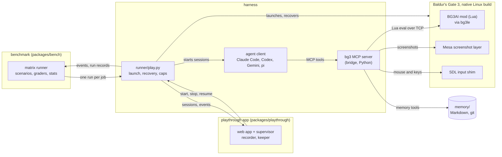

# bg3-agent-harness

A harness that lets an LLM agent play Baldur's Gate 3 on the native Linux build, a benchmark built on it, and an app
for watching an agent play the whole game. The harness is a Lua mod inside the game, an MCP server any MCP client
can use, and a runner that launches the game, starts the agent and recovers from crashes.

[](LICENSE)
[](bridge/pyproject.toml)
[](mod/Mods/BG3AI)
[](docs/SETUP.md)
[](#roadmap)

The mod runs in the game through [bg3le](https://github.com/lenonk/bg3le), a Linux port of Norbyte's Script
Extender. It hands the agent only what a human player could see at that moment, as compact text, plus a
screenshot of the real frame when the agent asks for one. The agent acts through the game's own UI commands,
engine actions, and mouse and keyboard input. It keeps a Markdown memory between sessions of up to an hour, and a
runner launches the game, recovers from crashes and shows a live dashboard. The agent is an MCP client. The runner
drives Claude Code by default, and Codex CLI, Gemini CLI or pi (any OpenAI-compatible endpoint, such as OpenRouter
or DeepSeek) on request.

This is a research harness and a work in progress. It has finished the game once, and the near goal is to turn it
into a benchmark that other agents and models can be measured on. Setup needs Linux, a Steam copy of the game and
some patience, and things break when the game updates.

## What it has done

| | claude-run-2 (full game) | Nautiloid series (opening chapter) |
|---|---|---|
| Goal | new game to the epilogue | new game until the party escapes the Nautiloid |
| Dates | 2026-10-09 to 2026-10-18 | 2026-10-13, 2026-10-16/17, 2026-10-17 |
| Result | reached the epilogue | 9 of 9 runs reached the goal |
| Sessions | 96 numbered (99 with crash restarts) | 3 series of 3 runs |
| Play time | 38.9 hours | 9 to 13 minutes of wall time per run |
| Model cost | $711, memory keeper included | mean per run: $4.34 in the first series, $3.30 in the second, $1.46 in the third |
| Tool calls | 20,809 | |
| Fights | 149 recorded by the harness, 91 of them with a reload | |
| Model | Claude Opus 5.5, medium effort | Claude Opus 5.5 |
| Difficulty | Explorer | Explorer |

The harness was fixed and improved while claude-run-2 went on, so the run shows that the whole game can be
finished through it. It is not a controlled measurement. In the Nautiloid series the cost per run fell as the
harness improved between series. Fights are the harness's own records: one per fight, graded when it ends.

### Known limits

- Explorer is the easiest difficulty.
- Many fights were won only after reloading and retrying.
- About 12% of tool calls in claude-run-2 returned a failure or a refusal (some only for part of a batch of
  actions). The agent usually recovered, at a cost in time.
- Until 2026-10-17 a harness bug let the agent cast spells its characters had not prepared. It is fixed, but the
  run had that advantage before then.
- Claude through Claude Code played the full game. The only other live play so far is DeepSeek Flash through pi,
  two short test runs on 2026-10-22 (the Nautiloid, and the crash site to the Emerald Grove). The Codex and Gemini
  clients are tested offline against stubs only.
- Every run so far used the agent text from before the overhaul, which was tuned on Claude's failures. The overhaul
  splits it into neutral rules and optional coaching, but no run has used the split text yet.
  [docs/BENCHMARK-BIAS.md](docs/BENCHMARK-BIAS.md) lists where the old text favoured Claude.

## Three packages

The repo is being reorganised into three packages with one-way dependencies
([docs/TARGET-ARCHITECTURE.md](docs/TARGET-ARCHITECTURE.md)). The benchmark and the app use only the harness, and
never each other. The work happens on the `overhaul` branch; the results above were measured before it.

| Package | What it is | Where |
|---|---|---|
| Harness | puts any agent in the game: the Lua mod, the bg3 MCP server, game launch and recovery, the clients (Claude Code, Codex CLI, Gemini CLI, and pi for any OpenAI-compatible endpoint), the rules text, the container sandbox | `mod/`, `bridge/`, `runner/`, `native/`, `patches/`, `tools/pi/`, `tools/container/`, `packages/harness/` |
| Benchmark | scenarios, graders over game facts, statistics, the matrix runner, reports and the leaderboard | [`packages/bench/`](packages/bench/README.md) |
| Playthrough app | plays the whole game for people to watch: launcher, live view, memory browser, timeline, recording, overlay and replay | [`packages/playthrough/`](packages/playthrough/README.md) |

The repo root is a [uv](https://docs.astral.sh/uv/) workspace with one lock file. `uv sync --locked` at the root
installs all of it with the dev tools; `uv sync --locked --package <name>` installs one package and what it needs.

**Harness** (`bg3-agent-harness` with `bg3harness`, and the MCP server `bg3ai-bridge` with `bg3ai`). The bg3 MCP
server is what any MCP client plays through. With the game running, it serves the game over stdio, or over HTTP
for a client elsewhere ([docs/MCP-SERVER.md](docs/MCP-SERVER.md)):

```bash
uv run --project bridge bg3ai-mcp --transport http --host 127.0.0.1 --port 8770
```

**Benchmark** (`bg3bench`). The matrix runner plans, runs and resumes models x scenarios x conditions x repeats
under one budget. `plan` prints the jobs and the reserve without running anything
([docs/BENCHMARK.md](docs/BENCHMARK.md)):

```bash
uv run --project packages/bench python -m bg3bench.matrix plan --matrix packages/bench/matrices/pilot-2026-10-22.toml
```

**Playthrough app** (`bg3play`). The web app and its server; build the web app once with
`cd packages/playthrough/web && npm ci && npm run build`, then from the repo root:

```bash
uv run --project packages/playthrough bg3play-serve --runtime runtime --playthroughs playthroughs
```



- The client's built-in tools are switched off, so its only tools are the bg3 server's. Memory, the session's
  start and end, and a rate-limited bg3.wiki lookup are bg3 tools too, so any MCP client gets the same tools. A
  session can switch tool groups off (memory, wiki, reloads, screenshots and others).
- The benchmark and the app reach the harness through `runner/play.py` for now, behind temporary adapters. They
  move to a `run_session` API when `play.py` is split (Phase D of [docs/OVERHAUL-PLAN.md](docs/OVERHAUL-PLAN.md)).
- [docs/QUICKSTART.md](docs/QUICKSTART.md): test your own model, use the MCP server from your own client, start
  the app.
- [docs/MCP-SERVER.md](docs/MCP-SERVER.md): the bg3 MCP server on its own, for your own client: start it, its
  settings, the rules it serves and which tools it offers.
- [docs/BENCHMARK.md](docs/BENCHMARK.md), [docs/FAIRNESS.md](docs/FAIRNESS.md) and
  [docs/STRESS-TEST.md](docs/STRESS-TEST.md): the benchmark protocol, what the agent may see, and the stress-test
  round over every kind of game situation.
- [docs/RELEASING.md](docs/RELEASING.md): how a version is bumped and a release tagged.
- [docs/ARCHITECTURE.md](docs/ARCHITECTURE.md): the design and the reasons behind each choice.
- [docs/PROTOCOL.md](docs/PROTOCOL.md): the contract between the mod and the bridge.
- [runner/README.md](runner/README.md): unattended play, recovery, run records and the old dashboard.
- [play/CLAUDE.md](play/CLAUDE.md): the playing agent's text for Claude Code, generated from
  `packages/harness/prompts/` (rules, plus coaching in the Claude Code condition).
- [CHANGELOG.md](CHANGELOG.md): versions, the `bench-v` tags and what changed.
- [research/](research/): the research notes behind the design.

## Fair play

Everything the agent receives is something a player could see on screen at that moment or remember having seen.
General game knowledge is allowed, the way a player who has read the wiki has it.

- Entities are reported only when a party member perceives them, using the engine's own sight checks. Hidden,
  invisible and sneaking creatures, undiscovered traps and secret doors stay hidden until the game reveals them.
- Each output is built from fields the game's UI shows. Disguised names stay disguised, story flags and internal
  ids never appear, and DCs show only where the game shows them (the roll screen and the pickpocket window).
- Containers show their contents only while the loot window is open. Navigation answers only from ground the party
  has seen or walked.
- Targets of an action must be perceivable, and cheat calls (teleport, add gold, set flags and so on) are blocked.
- The agent has no shell and no web access apart from the wiki tool. Its memory tools can reach only its own
  memory folder and the read-only knowledge folder.

Every session gets an automatic audit of what the agent was shown. [docs/FAIRNESS.md](docs/FAIRNESS.md) has the
eight enforcement layers, the audit and the judgment calls.

## Benchmark

The near goal is a suite of short, cheap scenarios that any model can be scored on: success, attempts, time to the
goal and cost. The full playthrough stays an occasional showcase. The plan is
[docs/BENCHMARK-PLAN.md](docs/BENCHMARK-PLAN.md), and [docs/BENCHMARK.md](docs/BENCHMARK.md) is the protocol for the
series that run today.

What exists now:

- Scenario files in four families (fights, sandbox goals, choices, exploration), each with a start point, a goal
  graded from game state, caps and a closed-book quiz for contamination checks
  ([packages/bench/README.md](packages/bench/README.md)). `nautiloid` is the only one that has run live; the others
  wait for their start saves.
- The ranked track runs every model through one frozen client, pi, with the rules text only. Claude Code, Codex
  and Gemini CLI are a separate "bring your own agent" condition.
- A series runner that freezes the game build, the mod, bg3le and the harness commit and refuses a run whose pins
  differ, and a matrix runner on top of it that queues models x scenarios x conditions x repeats under a global
  budget.
- A per-run dollar cap from the billed cost, required for pi, and a global budget file.
- A matrix command line (`python -m bg3bench.matrix plan|run|status|resume`) with a dry-run plan of the jobs and
  the budget reserve.
- Do-nothing and random baselines, a fairness probe for every tool, statistics with confidence intervals, a series
  report, a series view of the runs in progress, and a static leaderboard.
- A choices grader for the choice scenarios: the picks are compared across models, never scored, and a persona
  judge (any client profile, never the model under test) can rate how well they fit the character brief.
- A human baseline protocol ([docs/HUMAN-BASELINE.md](docs/HUMAN-BASELINE.md)): the owner plays each scenario from
  the same start save, and the attempts become a "human (owner)" leaderboard row. Not played yet.
- Offline end-to-end tests with no game and no key: a fake mod answers the real bridge's calls from a scripted game,
  and a scripted model plays through pi, so a scenario runs all the way to its graded result and the leaderboard.
  The do-nothing and random baselines are run against every scenario's start on the fake mod too.
- Cost caps that track what the endpoint bills. For DeepSeek's own API the runner computes the bill from DeepSeek's
  usage fields and its off-peak discount; a test run came to $0.25 against $0.24 actually billed.
- A container sandbox where the playing client can reach only the bg3 MCP server and its model API
  ([tools/container/README.md](tools/container/README.md)). It has not yet run on a real host with the firewall.

Nothing on the ranked track has been run yet, so there are no benchmark results to show.

## Requirements

- Baldur's Gate 3 bought on Steam and installed through it, the native Linux build (not the Windows build under
  Proton). Built and tested on Steam buildid 25605617 (Patch 8 Hotfix 10); other builds may need bg3le's
  addresses re-resolved.
- Linux with systemd user sessions, Mesa's `VK_LAYER_MESA_screenshot` Vulkan layer, Docker (to build bg3le and run
  the Lua tests), Python 3.12+ and [uv](https://docs.astral.sh/uv/).
- 16 GB RAM and a GPU with 4 GB or more. Tested on an NVIDIA RTX 3050 (4 GB) under PRIME offload and on an AMD RX
  6900 XT.
- An MCP client for the agent (Claude Code by default) and the API budget to run it.

## Quick start

Full setup and checks are in [docs/SETUP.md](docs/SETUP.md). To test your own model, read
[docs/QUICKSTART.md](docs/QUICKSTART.md).

```bash
git submodule update --init third_party/bg3le
tools/build_bg3le.sh                         # builds build/bg3le/dist/libbg3le.so (Docker, sniper toolchain)
runner/launch_game.sh --continue             # native BG3 + bg3le + our mod + capture layer (Steam must run)
cd bridge && PYTHONPATH=src python3 -m bg3ai.luadebug 'return Mods.BG3AI.BG3AI.rpc([[{"op":"sys.info"}]])'

python3 tools/memory/new_playthrough.py claude-run-1      # memory repo + play/memory symlink
python3 runner/play.py run --playthrough claude-run-1     # autonomous sessions
python3 runner/dashboard/serve.py --port 8765             # watch it play: http://localhost:8765
```

For a manual session, run `cd play && claude --tools ToolSearch`. The `bg3` MCP server and the rules are set up
in that folder. Runner options are in [runner/README.md](runner/README.md).

To run a benchmark series:

```bash
python3 tools/bench_preflight.py
python3 runner/play.py run --scenario nautiloid --runs 3 --playthrough naut-opus
python3 runner/play.py runs --playthrough naut-opus
```

<details>
<summary>Machine configuration</summary>

Nothing is tied to one machine. Every path has an env override and a default found at run time.

| What | Env | Default |
|---|---|---|
| game install | `BG3_DIR` | the Steam library listing app 1086940 (`tools/steam_paths.py game`) |
| Steam's sniper runtime | `BG3AI_SNIPER_DIR` | its library per `libraryfolders.vdf`, else next to the game |
| Steam root | `STEAM_ROOT` | `~/.steam/steam`, `~/.steam/debian-installation`, `~/.local/share/Steam`, Flatpak |
| Larian profile | `BG3AI_PROFILE_DIR` | `~/.local/share/Larian Studios/Baldur's Gate 3` (`steam_paths.py profile`) |
| saves / Script Extender files | `BG3AI_SAVE_DIR` / `BG3AI_SE_DIR` | `<profile>/PlayerProfiles/Public/Savegames/Story` / `<profile>/Script Extender` |
| runtime logs, shots, metrics | `BG3AI_RUNTIME` | `<repo>/runtime` |
| playthroughs (memory repos) | `BG3AI_PLAYTHROUGHS` | `<repo>/playthroughs` |
| NVIDIA PRIME offload | `BG3AI_PRIME=1\|0` | auto: on when an NVIDIA GPU and its Vulkan ICD are present |
| Steam must be offline | `BG3AI_REQUIRE_STEAM_OFFLINE=1\|0` | off, or on when `~/.config/bg3ai/require-steam-offline` exists |

The game runs in its own systemd user scope with a memory cap (`systemd-run --user --scope`), and OOM reasons come
from `journalctl --user`. Both degrade to a warning without systemd. `runner/launch_game.sh` lists every knob.

</details>

<details>
<summary>Repo map</summary>

| Path | What |
|---|---|
| [`mod/`](mod/Mods/BG3AI) | the Lua mod that runs in the game: perception filter, state, events, action guard, UI reader |
| [`bridge/`](bridge/) | the bg3 MCP server in Python: tools, rendering, memory sandbox, screenshots, input, wiki |
| [`runner/`](runner/) | game launcher, session runner, recovery, run records, memory keeper, dashboard |
| [`play/`](play/) | where the playing agent runs: its rules, MCP config and read-only knowledge |
| [`packages/harness/`](packages/harness/) | the agent's rules and coaching texts and the event and facts schemas |
| [`packages/bench/`](packages/bench/README.md) | the benchmark: scenarios v2, graders, statistics, matrix runner, reports |
| [`packages/playthrough/`](packages/playthrough/README.md) | the playthrough app: API server, web UI, recorder, supervisor |
| [`profiles/`](profiles/) | client profiles (client, model, endpoint) for `play.py --profile` |
| [`scenarios/`](scenarios/) | v1 scenario files, the ones `runner/play.py --scenario` reads today |
| [`memory-template/`](memory-template/) | the layout of a playthrough's memory |
| [`native/bg3sdl/`](native/bg3sdl/) | the SDL input shim (mouse and keys for the game window only) |
| [`patches/bg3le/`](patches/bg3le/) | crash fixes applied to bg3le at build time |
| [`third_party/`](third_party/) | bg3le as a pinned git submodule |
| [`tools/`](tools/) | build, preflight, pi, memory, log mining, saves, container sandbox, CI and dev checks |
| [`docs/`](docs/) | architecture, fairness, protocol, setup and benchmark docs |
| [`research/`](research/) | the research notes behind the design |

</details>

## Roadmap

The overhaul ([docs/OVERHAUL-PLAN.md](docs/OVERHAUL-PLAN.md)), in order:

- Live checks of what is built offline: pi with more models, the seeded dice, the referee and roll logs, the
  recorder, the container firewall.
- Split `runner/play.py` behind a `run_session` API, so the benchmark and the app stop going through the CLI.
- Benchmark content: neutral start saves, the first scenario set with oracle runs and baselines, a Nautiloid pilot
  on pi with five models, a Claude Code baseline on the same harness version, and the human baseline played.
- A stress-test round over every BG3 situation (movement, combat, dialogue, trade, stealth, inventory, party,
  puzzles, UI states) through Claude Code and pi.
- The first tagged release, `bench-v0.1`, after the owner settles the launch gate: Larian's AI clause, publishing
  start saves, the benchmark's name, and a scrub of personal paths from anything published.

Later: roleplay scored by a judge model, harder difficulties and held-out starts, play at the pace of a human
watching the screen, a stream overlay, and publishing claude-run-2's data.

## Contributing

Bug reports, fixes and new scenarios are welcome. [CONTRIBUTING.md](CONTRIBUTING.md) covers the offline tests,
code style and the fairness rule for any change to what the agent sees.

## Credits

- [bg3le](https://github.com/lenonk/bg3le) by lenonk (MIT), the native Linux port of
  [Norbyte's Script Extender](https://github.com/Norbyte/bg3se). It is a git submodule in `third_party/bg3le`,
  built with the crash-fix patches in `patches/bg3le/`.
- [bg3.wiki](https://bg3.wiki), the wiki the agent can look things up in.
- Baldur's Gate 3 is made and owned by Larian Studios. Nothing from the game is included here; you need your own
  copy on Steam.

## License

MIT, see [LICENSE](LICENSE). `third_party/bg3le` keeps its own MIT license. To cite this project, see
[CITATION.cff](CITATION.cff).
