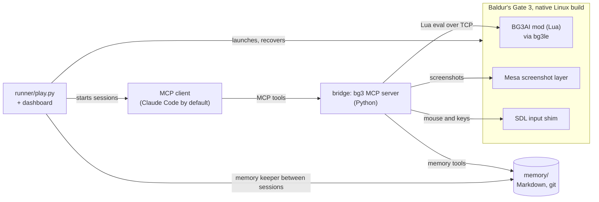

# bg3-agent-harness

A harness that lets an LLM agent play Baldur's Gate 3 on the native Linux build: a Lua mod inside the game, an MCP
server for any MCP client, an autonomous runner, a Markdown memory, and the tooling to run it as a benchmark.

[](LICENSE)
[](bridge/pyproject.toml)
[](mod/Mods/BG3AI)
[](docs/SETUP.md)
[](#roadmap)

The mod runs in the game through [bg3le](https://github.com/lenonk/bg3le), a Linux port of Norbyte's Script
Extender. It hands the agent only what a human player could see at that moment, as compact text, plus a
screenshot of the real frame when the agent asks for one. The agent acts through the game's own UI commands,
engine actions, and mouse and keyboard input. It keeps a Markdown memory between sessions of up to an hour, and a
runner launches the game, recovers from crashes and shows a live dashboard. The agent is an MCP client, and the
runner drives Claude Code by default.

This is a research harness and a work in progress. It has finished the game once, and the near goal is to turn it
into a benchmark that other agents and models can be measured on. Setup needs Linux, a Steam copy of the game and
some patience, and things break when the game updates.

## What it has done

| | claude-run-2 (full game) | Nautiloid series (opening chapter) |
|---|---|---|
| Goal | new game to the epilogue | new game until the party escapes the Nautiloid |
| Dates | 2026-10-09 to 2026-10-18 | 2026-10-13, 2026-10-16/17, 2026-10-17 |
| Result | reached the epilogue | 9 of 9 runs reached the goal |
| Sessions | 96 numbered (99 with crash restarts) | 3 series of 3 runs |
| Play time | 38.9 hours | 9 to 13 minutes of wall time per run |
| Model cost | $711, memory keeper included | mean per run: $4.34 in the first series, $3.30 in the second, $1.46 in the third |
| Tool calls | 20,809 | |
| Fights | 149 recorded by the harness, 91 of them with a reload | |
| Model | Claude Opus 5.5, medium effort | Claude Opus 5.5 |
| Difficulty | Explorer | Explorer |

The harness was fixed and improved while claude-run-2 went on, so the run shows that the whole game can be
finished through it. It is not a controlled measurement. In the Nautiloid series the cost per run fell as the
harness improved between series. Fights are the harness's own records: one per fight, graded when it ends.

### Known limits

- Explorer is the easiest difficulty.
- Many fights were won only after reloading and retrying.
- About 12% of tool calls in claude-run-2 returned a failure or a refusal (some only for part of a batch of
  actions). The agent usually recovered, at a cost in time.
- Until 2026-10-17 a harness bug let the agent cast spells its characters had not prepared. It is fixed, but the
  run had that advantage before then.
- Only Claude has played. The Codex and Gemini wiring exists and has not played a live session.
- The text the agent reads (rules, playbooks, tool descriptions) was tuned on Claude's failures, so it is not a
  neutral benchmark yet. [docs/BENCHMARK-BIAS.md](docs/BENCHMARK-BIAS.md) lists where.

## How it works



- The client's built-in tools are switched off, so its only tools are the bg3 server's (94 of them). Memory, the
  session's start and end, and a rate-limited bg3.wiki lookup are bg3 tools too, so any MCP client gets the
  same tools.
- Between sessions a short memory-keeper pass brings the curated memory files up to date from the session logs.
- [docs/ARCHITECTURE.md](docs/ARCHITECTURE.md): the design and the reasons behind each choice.
- [docs/PROTOCOL.md](docs/PROTOCOL.md): the contract between the mod and the bridge.
- [runner/README.md](runner/README.md): unattended play, recovery, run records and the dashboard.
- [play/CLAUDE.md](play/CLAUDE.md): the playing agent's rules; [play/knowledge/](play/knowledge/) holds its
  playbooks.
- [research/](research/): the research notes behind the design.

## Fair play

Everything the agent receives is something a player could see on screen at that moment or remember having seen.
General game knowledge is allowed, the way a player who has read the wiki has it.

- Entities are reported only when a party member perceives them, using the engine's own sight checks. Hidden,
  invisible and sneaking creatures, undiscovered traps and secret doors stay hidden until the game reveals them.
- Each output is built from fields the game's UI shows. Disguised names stay disguised, story flags and internal
  ids never appear, and DCs show only where the game shows them (the roll screen and the pickpocket window).
- Containers show their contents only while the loot window is open. Navigation answers only from ground the party
  has seen or walked.
- Targets of an action must be perceivable, and cheat calls (teleport, add gold, set flags and so on) are blocked.
- The agent has no shell and no web access apart from the wiki tool. Its memory tools can reach only its own
  memory folder and the read-only knowledge folder.

Every session gets an automatic audit of what the agent was shown. [docs/FAIRNESS.md](docs/FAIRNESS.md) has the
eight enforcement layers, the audit and the judgment calls.

## Benchmark

The near goal is a suite of short, cheap scenarios that any MCP client can be scored on: success, attempts, time
to the milestone and cost. The full playthrough stays an occasional showcase.

What exists now:

- Scenarios as JSON files with a start point, an end milestone, caps and a character profile
  ([scenarios/README.md](scenarios/README.md)). `nautiloid` is ready and is the only one that has run live.
  `crash_site_grove`, `act1_underdark` and `act2_last_light` each need a start save made once by hand.
- A series runner that freezes the game build, the mod, bg3le and the harness commit, and refuses a run whose
  pins differ. Each run writes one record with its outcome, time, cost, tokens and failures.
- A read-only preflight, `tools/bench_preflight.py`, that checks the machine before a series.
- `--client claude|codex|gemini`. Only Claude has played live.
- A container sandbox where the playing client can reach only the bg3 MCP server and its own model API
  ([tools/container/README.md](tools/container/README.md)). It is built and has not yet run on a real host with
  the firewall.

What comes next: more scenarios with start saves (a boss fight, the invisible-floor Faith-Leap trial, an
exploration leg), live runs of other clients, and splitting the agent's text into rules and coaching so it stops
favouring Claude. The protocol is in [docs/BENCHMARK.md](docs/BENCHMARK.md), and
[docs/BENCHMARK-BIAS.md](docs/BENCHMARK-BIAS.md) is the bar for a fair cross-model result.

## Requirements

- Baldur's Gate 3 bought on Steam and installed through it, the native Linux build (not the Windows build under
  Proton). Built and tested on Steam buildid 25605617 (Patch 8 Hotfix 10); other builds may need bg3le's
  addresses re-resolved.
- Linux with systemd user sessions, Mesa's `VK_LAYER_MESA_screenshot` Vulkan layer, Docker (to build bg3le and run
  the Lua tests), Python 3.12+ and [uv](https://docs.astral.sh/uv/).
- 16 GB RAM and a GPU with 4 GB or more. Tested on an NVIDIA RTX 3050 (4 GB) under PRIME offload and on an AMD RX
  6900 XT.
- An MCP client for the agent (Claude Code by default) and the API budget to run it.

## Quick start

Full setup and checks are in [docs/SETUP.md](docs/SETUP.md).

```bash
git submodule update --init third_party/bg3le
tools/build_bg3le.sh                         # builds build/bg3le/dist/libbg3le.so (Docker, sniper toolchain)
runner/launch_game.sh --continue             # native BG3 + bg3le + our mod + capture layer (Steam must run)
cd bridge && PYTHONPATH=src python3 -m bg3ai.luadebug 'return Mods.BG3AI.BG3AI.rpc([[{"op":"sys.info"}]])'

python3 tools/memory/new_playthrough.py claude-run-1      # memory repo + play/memory symlink
python3 runner/play.py run --playthrough claude-run-1     # autonomous sessions
python3 runner/dashboard/serve.py --port 8765             # watch it play: http://localhost:8765
```

For a manual session, run `cd play && claude --tools ToolSearch`. The `bg3` MCP server and the rules are set up
in that folder. A client in a container reaches the server over HTTP, as described in
[tools/container/README.md](tools/container/README.md). Runner options are in [runner/README.md](runner/README.md).

To run a benchmark series:

```bash
python3 tools/bench_preflight.py
python3 runner/play.py run --scenario nautiloid --runs 3 --playthrough naut-opus
python3 runner/play.py runs --playthrough naut-opus
```

<details>
<summary>Machine configuration</summary>

Nothing is tied to one machine. Every path has an env override and a default found at run time.

| What | Env | Default |
|---|---|---|
| game install | `BG3_DIR` | the Steam library listing app 1086940 (`tools/steam_paths.py game`) |
| Steam's sniper runtime | `BG3AI_SNIPER_DIR` | its library per `libraryfolders.vdf`, else next to the game |
| Steam root | `STEAM_ROOT` | `~/.steam/steam`, `~/.steam/debian-installation`, `~/.local/share/Steam`, Flatpak |
| Larian profile | `BG3AI_PROFILE_DIR` | `~/.local/share/Larian Studios/Baldur's Gate 3` (`steam_paths.py profile`) |
| saves / Script Extender files | `BG3AI_SAVE_DIR` / `BG3AI_SE_DIR` | `<profile>/PlayerProfiles/Public/Savegames/Story` / `<profile>/Script Extender` |
| runtime logs, shots, metrics | `BG3AI_RUNTIME` | `<repo>/runtime` |
| playthroughs (memory repos) | `BG3AI_PLAYTHROUGHS` | `<repo>/playthroughs` |
| NVIDIA PRIME offload | `BG3AI_PRIME=1\|0` | auto: on when an NVIDIA GPU and its Vulkan ICD are present |
| Steam must be offline | `BG3AI_REQUIRE_STEAM_OFFLINE=1\|0` | off, or on when `~/.config/bg3ai/require-steam-offline` exists |

The game runs in its own systemd user scope with a memory cap (`systemd-run --user --scope`), and OOM reasons come
from `journalctl --user`. Both degrade to a warning without systemd. `runner/launch_game.sh` lists every knob.

</details>

<details>
<summary>Repo map</summary>

| Path | What |
|---|---|
| [`mod/`](mod/Mods/BG3AI) | the Lua mod that runs in the game: perception filter, state, events, action guard, UI reader |
| [`bridge/`](bridge/) | the bg3 MCP server in Python: tools, rendering, memory sandbox, screenshots, input, wiki |
| [`runner/`](runner/) | game launcher, session runner, recovery, run records, memory keeper, dashboard |
| [`play/`](play/) | where the playing agent runs: its rules, MCP config and read-only knowledge |
| [`scenarios/`](scenarios/) | fixed start points for benchmark series |
| [`memory-template/`](memory-template/) | the layout of a playthrough's memory |
| [`native/bg3sdl/`](native/bg3sdl/) | the SDL input shim (mouse and keys for the game window only) |
| [`patches/bg3le/`](patches/bg3le/) | crash fixes applied to bg3le at build time |
| [`third_party/`](third_party/) | bg3le as a pinned git submodule |
| [`tools/`](tools/) | build, preflight, memory, log mining, container sandbox and dev checks |
| [`docs/`](docs/) | architecture, fairness, protocol, setup and benchmark docs |
| [`research/`](research/) | the research notes behind the design |

</details>

## Roadmap

Near term, the benchmark:

- A small suite of short scenarios, each scored on success, attempts, cost and time.
- Live runs with clients other than Claude Code.
- The container sandbox run on a real host with the firewall.
- The agent's text split into rules (how the game, the tools and fairness work) and coaching (advice written after
  one model's mistakes), with Claude's session anecdotes taken out.

Longer term:

- Roleplay. Each playthrough gets a character brief that the agent turns into a build and a persona at character
  creation, and its choices are meant to follow it. A judge model can score how well a run's decisions fit the
  persona (`runner/judge.py`, not yet run live).
- Harder difficulties, other characters and classes, and held-out starts the prompts were never tuned on.
- Play at the pace of a skilled human watching the screen. Latency (idle time between actions, long gaps, round
  trips) is measured every session.
- A stream overlay built on the dashboard's feeds.
- Publishing the playthrough data: session transcripts, metrics and memory.

## Contributing

Bug reports, fixes and new scenarios are welcome. [CONTRIBUTING.md](CONTRIBUTING.md) covers the offline tests,
code style and the fairness rule for any change to what the agent sees.

## Credits

- [bg3le](https://github.com/lenonk/bg3le) by lenonk (MIT), the native Linux port of
  [Norbyte's Script Extender](https://github.com/Norbyte/bg3se). It is a git submodule in `third_party/bg3le`,
  built with the crash-fix patches in `patches/bg3le/`.
- [bg3.wiki](https://bg3.wiki), the wiki the agent can look things up in.
- Baldur's Gate 3 is made and owned by Larian Studios. Nothing from the game is included here; you need your own
  copy on Steam.

## License

MIT, see [LICENSE](LICENSE). `third_party/bg3le` keeps its own MIT license. To cite this project, see
[CITATION.cff](CITATION.cff).
