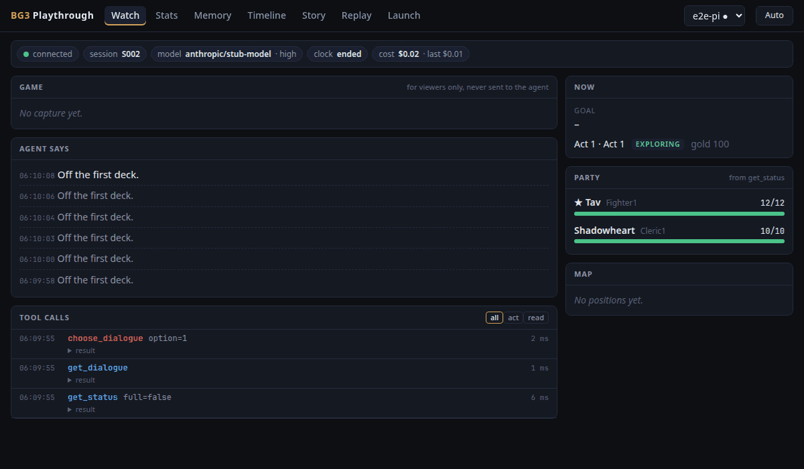
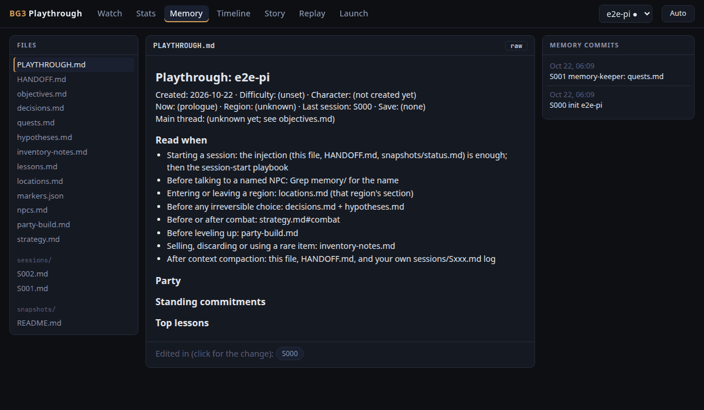
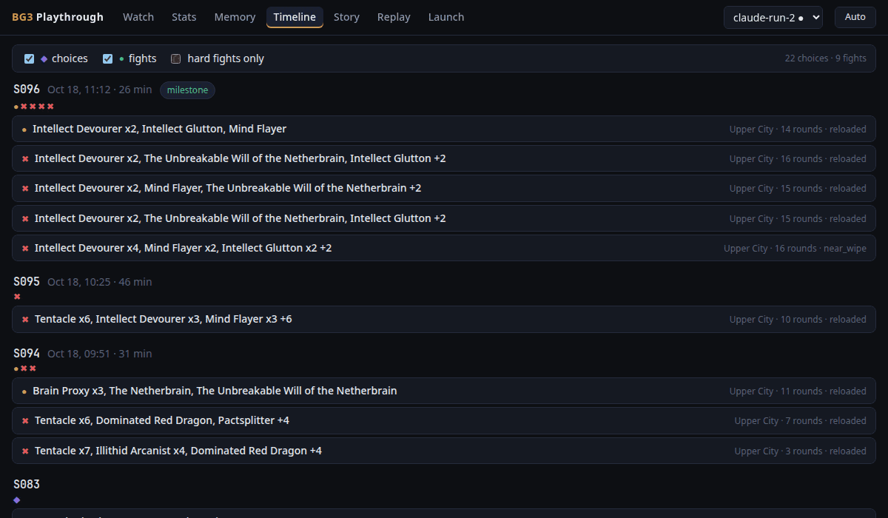
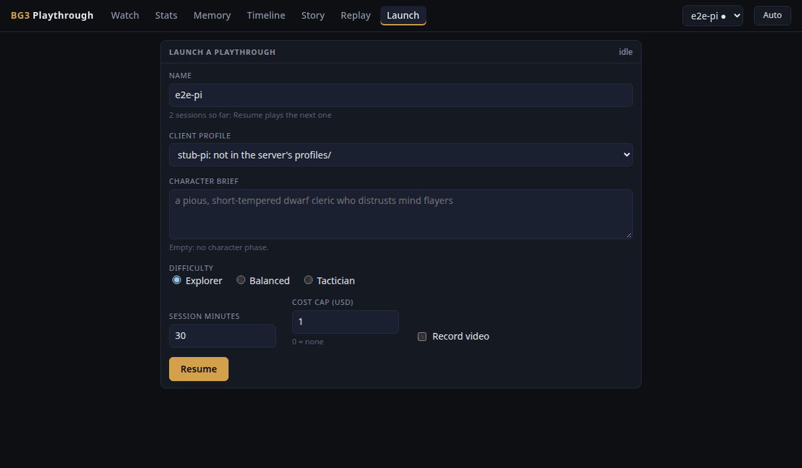

# The playthrough app (bg3play)

bg3play lets people watch an agent play Baldur's Gate 3 from start to end. It is a small Python HTTP server
(`bg3play-serve`, standard library only) plus a Svelte web app. It shows what the agent sees, says and does, its
memory, a timeline of choices and fights, recorded video next to the session's events, and a stream overlay. With
`--supervise` it also starts, stops and resumes multi-session playthroughs from the browser.

It reads the files the runner and the agent's tools write (`runtime/`, `playthroughs/`). It never imports the
benchmark. The code is in `packages/playthrough` (`src/bg3play` for the server, `web/` for the app).



## Install

From the repo root (a uv workspace with one lock file):

```bash
uv sync --locked --package bg3play          # the server and what it needs (bg3-agent-harness)
cd packages/playthrough/web
npm ci && npm run build                     # the web app into web/dist; the server serves that folder
cd ../../..
```

Node is only needed to build the web app. Rebuild after changing anything under `web/src`.

## Run it

```bash
uv run --project packages/playthrough bg3play-serve --runtime runtime --playthroughs playthroughs
# bg3play: http://127.0.0.1:8780/  (runtime runtime)
```

Open http://127.0.0.1:8780/. Without other flags the server only reads files: it follows the playthrough the runner
last played (`runtime/runner.status.json`) and refreshes every half second. The page's top-right picker switches
playthrough ("Auto" follows the runner again).

Flags (`bg3play-serve --help` lists all of them):

| Flag | Default | What |
|---|---|---|
| `--runtime DIR` | `$BG3AI_RUNTIME` or `runtime` | the runner's runtime folder |
| `--playthroughs DIR` | `playthroughs` | one folder per playthrough (settings, memory) |
| `--playthrough NAME` | the runner's current one | follow this playthrough |
| `--host`, `--port` | `127.0.0.1`, `8780` | where to listen |
| `--token TOKEN` | `$BG3PLAY_TOKEN` | bearer token that writes from off localhost need |
| `--web DIR` | `packages/playthrough/web/dist` | the built web app |
| `--poll S` | `0.5` | seconds between file checks |
| `--supervise` | off | turn on the Launcher's Start, Stop and Resume |
| `--session-runner` | `harness` | `harness`: bg3harness `run_session` against a game that is already running; `legacy`: `runner/play.py run`, which also launches the game and loads saves |
| `--repo DIR` | this checkout | where `profiles/` and `play/` are read from (`--supervise`) |
| `--record` | off | record the game window into MP4 segments |
| `--video DIR` | `<runtime>/video` | where recordings go |
| `--capture` | `window` | `window` grabs the game window, `display` the whole X display |
| `--display` | `$DISPLAY` or `:1` | the X display the game runs on |
| `--encoder` | `h264_nvenc` | or `libx264` (CPU) |
| `--video-cap-gb` | `20` | delete the oldest segments above this |
| `--game` | off | poll the game's status and events while someone has the Stats screen open |
| `--status-interval S` | `3` | seconds between those polls |
| `--screen` | off | capture game frames while someone watches (`--record` has its own live view) |
| `--screen-interval S`, `--screen-width PX` | `5`, `1280` | how often and how wide |
| `--positions` | off | sample party positions for the map |
| `--debug-port PORT` | `$BG3LE_DEBUG_PORT` or `9998` | the mod's RPC port (`--game`, `--positions`, `--supervise`) |
| `--memory-dir DIR` | the runner's playthrough's | the memory the Stats and Story screens read |
| `--verbose` | off | log every request |

Writes (start, stop, resume) are refused from another site's page, and from anywhere but localhost unless the
request carries the token (`Authorization: Bearer <token>`). Keep the default `--host 127.0.0.1` unless you set a
token.

## What needs the game

Works offline, on files alone: Watch (for a session that has ended), Memory, Timeline, Story, Replay, the Launcher
form, the overlay and the JSON API. You can point the server at a copy of someone's `runtime/` and `playthroughs/`
and browse the whole run.

Needs BG3 running with the mod: `--game`, `--screen` and `--positions` (they talk to the mod on `--debug-port`),
`--record` (it grabs the game window, so it needs the game's `DISPLAY` and `XAUTHORITY`), and playing a session
through `--supervise`. The default `harness` session runner attaches to a game that is already running and has a
save loaded; `--session-runner legacy` launches the game itself through `runner/play.py`.

## Screens

- **Watch**: the game capture (shown to viewers only, never sent to the agent), what the agent says, its tool calls
  with results (filter all / act / read), goal, area, party HP, the map and the session's cost.
- **Stats**: the session clock, live game state and events (`--game`), screen capture (`--screen`), the latency
  numbers, story progress and a per-session goal scorecard.
- **Memory**: the agent's memory files (`playthroughs/<pt>/memory`) rendered, each with the commits that changed it.
  Click a session tag to see that commit's diff. The right column lists every memory commit.
- **Timeline**: per session, the choices (from `memory/decisions.md`) and the fights (from `Sxxx.fights.jsonl`),
  with a "hard fights only" filter.
- **Story**: the chapter summaries (`memory/chapters/`), the overview and the party snapshot.
- **Replay**: one session's events against its recorded video. Play at 1x to 64x, or step event by event. Sessions
  without video still step through their events.
- **Launch**: pick a name, a client profile, a character brief, difficulty, session minutes, a cost cap and whether
  to record; then Start (a new playthrough) or Resume (the next session of an existing one).
- **Overlay** (`/overlay`): a transparent 1920x1080 page for OBS as a browser source: last action, goal, what the
  agent says, party HP and the clock.





## Starting a playthrough

Start the server with `--supervise`. A new playthrough needs its memory first:

```bash
uv run --project packages/playthrough python -m bg3play.memory.new_playthrough ilse
```

That creates `playthroughs/ilse/memory` as a git repo and points the `play/memory` symlink at it (`--no-link` leaves
the symlink alone). Without it the session's memory can't open (session.py start answers "BG3 memory: no memory
directory at ...").

Then open Launch, type the name and press Start. The Supervisor plays one session after another. It ends the run
when you press Stop, the hours budget (`[session] hours`) is spent, the story is finished, the game ran out of
memory twice in a row, three sessions crashed in a row, or a session failed with an error. Stop is soft:
the running session is asked to finish and no new one starts. One playthrough runs at a time (one game). Between
sessions the memory keeper updates the memory and commits it. The run's history and the reason it ended are in
`runtime/sessions/<pt>/supervisor.json`; the Launcher's top-right corner shows the current state.

Client profiles are the TOML files in the repo's `profiles/` (`claude`, `codex`, `gemini` use their CLI's own login;
`pi` profiles name a provider and the environment variable that holds its key, read from the machine's `.env`). If
a playthrough names a profile the server doesn't have, the Launcher says so and won't send it.



## Settings: playthrough.toml

Each playthrough's settings live in `playthroughs/<pt>/playthrough.toml`. The Launcher writes its fields into it on
Start and Resume; the rest you edit by hand. Missing keys take the defaults below, and unknown keys are an error, so
a typo is refused rather than ignored. Keys and secrets never go in this file.

```toml
v = 1
name = "ilse"
difficulty = ""                  # "" (the game's default) | Explorer | Balanced | Tactician

[agent]
profile = ""                     # a client profile (profiles/<name>.toml); "" = client and model below
client = "claude"                # claude | codex | gemini | pi
model = "opus"
effort = ""                      # "" = the client's default | low | medium | high | xhigh | max
condition = "rules+coaching"     # rules | rules+coaching

[character]
brief = ""                       # e.g. "a pious, short-tempered dwarf cleric"; "" = no character phase
roleplay = "strict"              # strict | light
name = ""
constraints = ""

[session]
minutes = 60.0                   # per session
hours = 0.0                      # total for this run of the Supervisor; 0 = until stopped or the game ends
max_cost_usd = 0.0               # cost cap per session; 0 = none; a pi profile needs one

[keeper]
enabled = true
model = ""                       # "" = the play model
effort = "low"
minutes = 5.0
max_cost_usd = 0.05              # cost cap of one keeper pass on a paid client (pi); 0 is refused there

[recording]
enabled = true
fps = 15
height = 720
```

**Prompt condition.** `condition` picks the text the agent is served and goes to the agent and the bg3 MCP server as
`BG3AI_PROMPT_CONDITION`. A playthrough defaults to `rules+coaching`. Benchmark runs use `rules` only
(docs/BENCHMARK-BIAS.md).

**Keeper cost.** On a paid client (pi) each keeper pass is capped at `[keeper] max_cost_usd` (default $0.05) and
also needs the global budget file `runtime/budget.json`; the pass is refused without either, or when the budget is
spent, and its cost is added to the budget when it ends. Subscription clients (claude, codex, gemini) have no keeper
cap.

**Recording.** `enabled` switches the recorder on or off per playthrough when the server runs with `--record`.
`fps` and `height` are checked but not applied yet: the recorder records at 15 fps, 1280x720.

An older playthrough with only a `profile.json` loads its character and difficulty from it.
`bg3play.config.migrate` writes `playthrough.toml` from it and leaves `profile.json` in place, because the runner
still reads it.

## Where things live

| Path | What |
|---|---|
| `playthroughs/<pt>/playthrough.toml` | the playthrough's settings |
| `playthroughs/<pt>/memory/` | the agent's memory, a git repo: `PLAYTHROUGH.md`, `HANDOFF.md`, `decisions.md`, `sessions/Sxxx.md`, `chapters/`, ... |
| `runtime/runner.status.json` | the session being played (or the last one) |
| `runtime/actions.jsonl`, `runtime/metrics.jsonl` | every tool call; latency samples |
| `runtime/sessions/<pt>/Sxxx.log` | one session's agent log |
| `runtime/sessions/<pt>/runner.json` | per-session history (exit, reason, save owner) |
| `runtime/sessions/<pt>/supervisor.json` | the Supervisor's history (outcome, progress per session) |
| `runtime/sessions/<pt>/keeper_history.jsonl`, `Sxxx-keeper.*` | memory keeper passes and their logs |
| `runtime/sessions/<pt>/Sxxx.fights.jsonl`, `positions.jsonl` | fights; party positions for the map |
| `runtime/budget.json` | the global USD budget paid clients draw from |
| `<runtime>/video/` | recorded segments (`rec-<run>-<n>.mp4`, 10 minutes each) and `index.json` |

## Recording

`--record` runs ffmpeg against the game window (`x11grab`) while the game runs, in 10-minute MP4 segments. It
needs the same `DISPLAY` and `XAUTHORITY` as the game. It stops when RAM or heat runs high and deletes the oldest
segments above `--video-cap-gb`. Replay matches segments to sessions by wall-clock time. Use `--encoder libx264`
on a machine without an NVIDIA encoder.

## Trying it offline

The playthrough end-to-end test plays two short sessions through the real bridge on a fake mod and a scripted stub
model (no game, no key, no network), with the memory keeper between them:

```bash
cd tools/pi && npm ci --ignore-scripts && cd ../..        # once: the pi client
uv run --project packages/playthrough pytest -m e2e packages/playthrough/tests/e2e/test_playthrough_offline.py \
  --basetemp /tmp/bg3play-demo
uv run --project packages/playthrough bg3play-serve \
  --runtime /tmp/bg3play-demo/pt0/runtime --playthroughs /tmp/bg3play-demo/pt0/playthroughs --supervise
```

The Watch, Memory and Launcher pictures above come from that run (playthrough `e2e-pi`); the Timeline picture is
from the recorded fixture run in `packages/playthrough/tests/fixtures/run`. Shots from a real recorded run are in
the [package README](../packages/playthrough/README.md).

## Tests

```bash
cd packages/playthrough
uv run pytest -q tests                          # API, store, supervisor, recorder (fake ffmpeg), config, memory
cd web && npm ci && npm run check && npm test   # svelte-check, tsc, vitest
cd .. && uv run pytest -q tests -m e2e          # Playwright against the built app (npm run build first)
```
