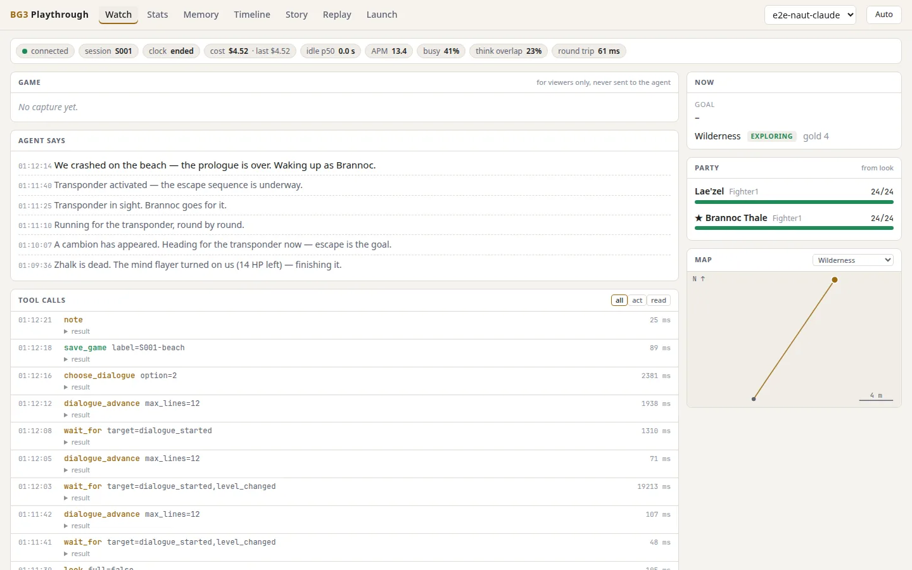
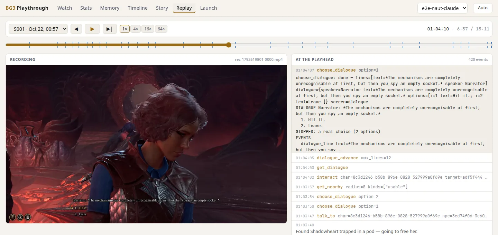
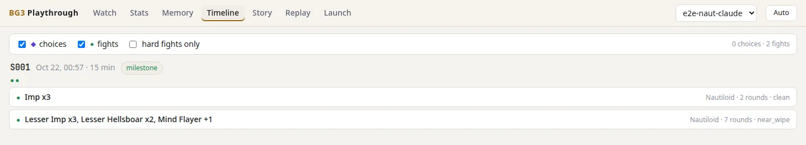
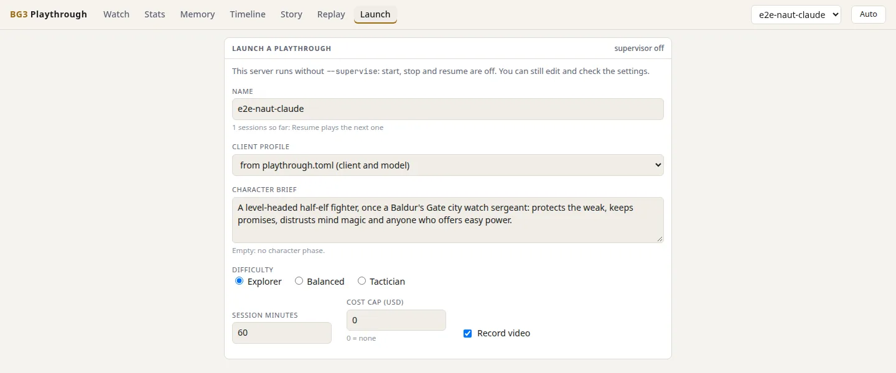

# bg3play: the playthrough app

Plays the whole game for people to watch: a launcher to pick the client, model, persona and difficulty, a live view
of the screen and the agent, the memory, a timeline of choices and fights, recording, a stream overlay and replay.
It reads the runner's files (`runtime/`, `playthroughs/`) and starts sessions through `runner/play.py`; it never
imports the benchmark.

Version: `pyproject.toml` (0.1.0).

## Start it

```bash
cd packages/playthrough/web && npm ci && npm run build      # once: the web app into web/dist
cd ../../..                                                 # back to the repo root
uv run --project packages/playthrough bg3play-serve --runtime runtime --playthroughs playthroughs
# open http://127.0.0.1:8780/
```

Useful options (`bg3play-serve --help` has all of them):

| Option | What |
|---|---|
| `--playthrough NAME` | follow this playthrough (default: the one the runner is playing) |
| `--supervise` | turn on the Launcher's start, stop and resume (each session is a `runner/play.py run`) |
| `--record` | record the game into MP4 segments under `<runtime>/video` (`--video`, `--video-cap-gb`, `--encoder`) |
| `--positions` | sample party positions for the breadcrumb map (reads the mod on `--debug-port`, 9998) |
| `--host`, `--port`, `--token` | binds 127.0.0.1:8780; writes from off localhost need the bearer token (`$BG3PLAY_TOKEN`) |

Screens: Watch (screen, reasoning, party, goal, cost), Memory, Timeline, Launcher, Overlay (`/overlay`, a
transparent 1920x1080 page for OBS) and Replay (a session's events in step with its recorded video).

The shots below are from a real recorded run (playthrough `e2e-naut-claude`, 2026-10-22: Claude Code on Opus 5.5,
one 15-minute session through the Nautiloid), served offline from its copied `runtime/`.

Watch, after the session ended (the game capture shows only while a game runs):



Replay, 7 minutes in: the recording next to the tool calls at that moment:



Timeline: the session's fights (choices come from `decisions.md`, which this run left empty):



Launcher, on a server started without `--supervise`:



The recorder runs ffmpeg against the game window. It needs the same `DISPLAY` and `XAUTHORITY` as the game, stops
when RAM or heat runs high, and deletes the oldest segments above the disk cap (20 GB by default).

Each playthrough's settings are in `playthroughs/<name>/playthrough.toml`. `bg3play.config.migrate` writes it from an
older `profile.json` and leaves that file in place, because the runner still reads it.

## Tests

```bash
cd packages/playthrough
uv run pytest -q tests                         # API, store, supervisor, recorder (fake ffmpeg), config
cd web && npm ci && npm run check && npm test  # svelte-check, tsc, vitest
cd .. && uv run pytest -q tests -m e2e         # Playwright against the built app (npm run build first)
```

## Status (2026-10-21)

Built and tested offline against a recorded fixture run. The recorder was checked live once with the game running;
the supervisor and the Launcher have not started a real session yet.
